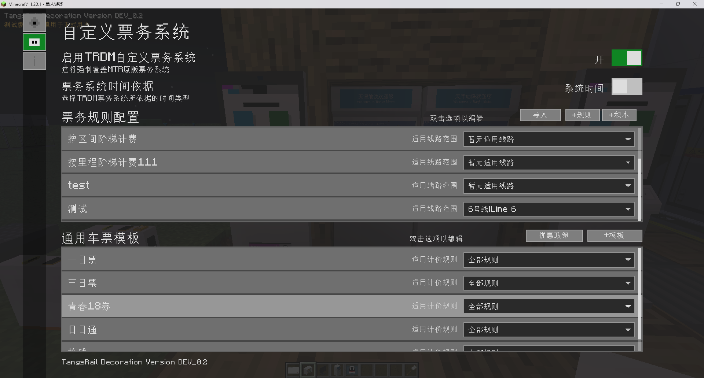
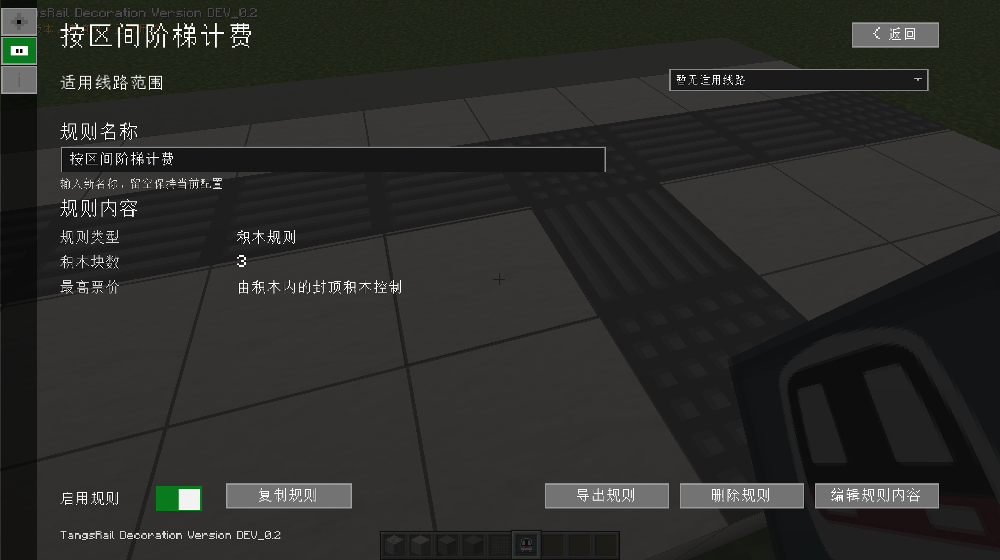

> 此页面尚未编写完成。
# 自定义票务规则

在单人游戏或有管理权限的服务器内，您可以通过TRDM提供的图形化编程界面自由编辑票务系统的计费规则并选择适用范围。

## 开始之前

不需要编程基础，但如果有Scratch这类图形化编程软件使用经验或接触过计算机编程为佳。 ~~政治选修3学的好的也来~~

## 界面速览

通用设置页面中的自定义票务系统设置界面的“票务规则设置”栏目将是本文所重点介绍的内容。

票务规则只对选定的适用线路生效。单人游戏内或多人游戏的服务器管理员可以编辑某条规则适用的线路。

TRDM预设了一些计费规则，你可以双击对应的选项查看详细信息和打开图形化编程编辑器。也可以点击“+规则”或“+积木”按钮新建一个票务规则。

你可以通过拖拽TRDM票务规则配置的JSON文件来导入票务规则。

双击选项后可打开计费规则设置。可以选择规则适用的游戏内线路范围，编辑名称，导出规则设置为JSON文件等操作。

点击“编辑规则内容”按钮可打开图形化编程界面，配置规则内容。