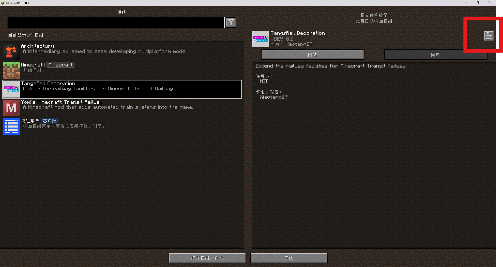
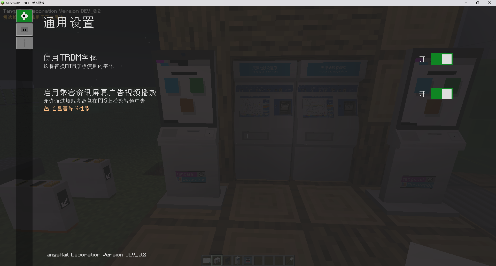
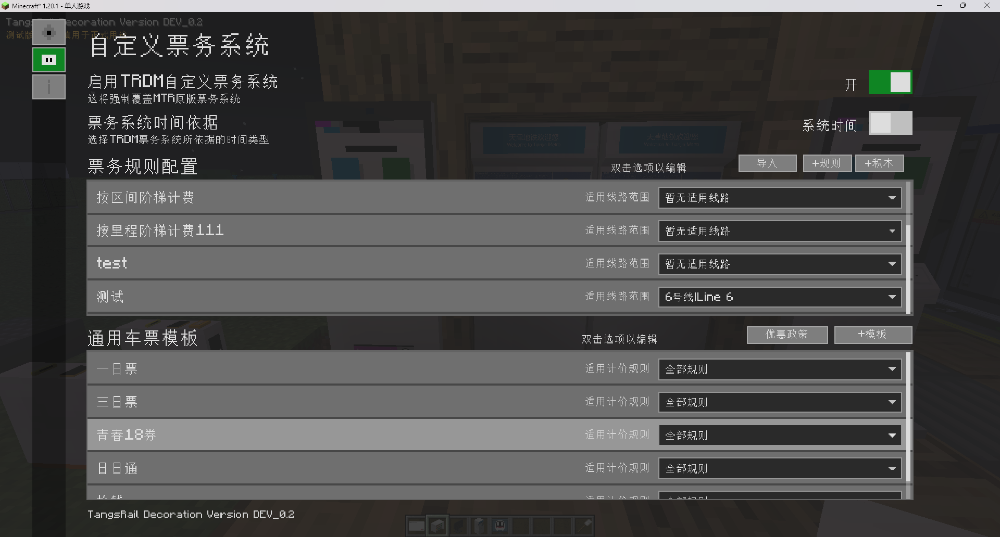

# 通用设置页面

## 界面入口

在游戏内输入以下指令可打开TRDM的设置界面：
```
/trdm config
```
如果安装Modmenu模组，可以在Modmenu的模组列表内打开TRDM的设置页面。如图所示。



## 界面操作
### 通用设置
该界面外观如下。



| 选项 | 说明 |
|---|---|
| 使用TRDM字体 |开启后将强制替换MTR原版的指示牌/吊板等使用的字体 |
| 启用乘客咨询屏幕广告视频播放| 关闭后将无法在PIS屏幕上播放视频广告。|

### 票务设置

该界面外观如下。



|选项|说明|
|---|---|
|启用TRDM票务系统|开启后将强制替换MTR原版的票务系统（包括计费逻辑和储值系统等），<br>且通过使用MTR原版逻辑的闸机必须手持TRDM票卡物品|
|票务系统时间依据|选择```系统时间```选项，TRDM票务系统所有规则将按照当前设备/服务器的系统时间计算处理<br>反之亦然。|
|票务规则配置|可以新建、删除、导入导出车费计费规则和选择计费规则适用的线路。<br>有关票务规则配置的内容请参见[自定义规则](../面向开发者/自定义票务设置/zidingyiguize.md)相关文档。|
|通用车票模板|可以新建、删除、导入导出通用车票模板和选择车票所适用的计费规则。<br>有关通用车票模板的内容请参见[自定义通票](../面向开发者/自定义票务设置/zidingyitongpiao.md)相关文档。|

> 在服务器内，如果您没有服务器操作员（op）权限，将不能编辑票务系统有关功能，票务规则配置和通用车票模板编辑器是只读状态。<br>如需要编辑，请联系服务器管理员获得权限或代为修改。